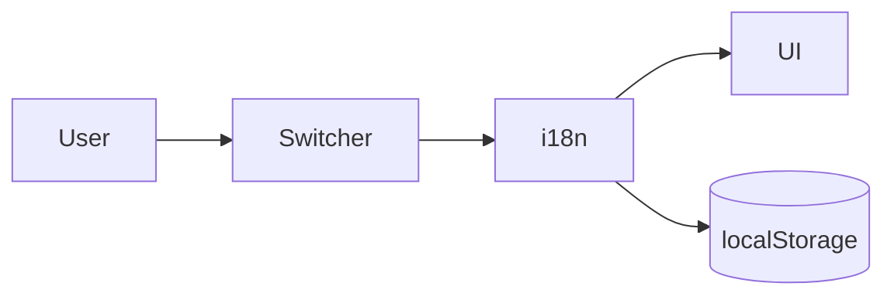

# System Patterns — i18n

## Архитектура
- `cascadia-web/src/i18n/config.ts` — init i18next, detection order: localStorage → navigator, fallbackLng en.
- `cascadia-web/src/i18n/types.ts` — Language = 'en' | 'ru'.
- `cascadia-web/src/i18n/locales/en/*.json`, `ru/*.json` — словари по неймспейсам.
- `LanguageSwitcher.tsx` в `components/layout/`, монтируется в Header рядом с ThemeToggle.
- `__root.tsx`: ThemeProvider → I18n init (импорт config до рендера).

## Потоки
- Переключение → i18n.changeLanguage → localStorage + document.lang → ре-рендер через useTranslation.
- Форматы: Intl / toLocale* с текущей локалью.

